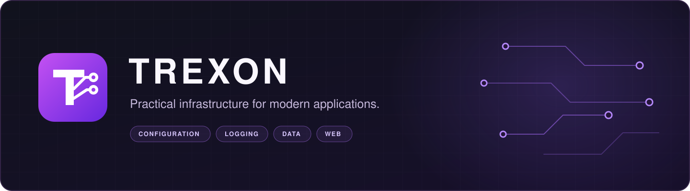

<div align="center">



**Focused .NET libraries. Clear APIs. Less setup.**

Use one package or bring the pieces together — from configuration and logs to a working HTTP service.

[Create an API](#create-your-first-api) · [Explore the packages](#the-building-blocks) · [Run the demo](#see-it-working) · [Documentation](#documentation--feedback)


</div>

---

## Create your first API

Start with a working application and make it your own:

```sh
dotnet new install Trexon.Templates
dotnet new trexon-api -n MyApi
cd MyApi
dotnet run
```

Open **[Swagger UI → http://127.0.0.1:5090/docs](http://127.0.0.1:5090/docs)**.
Create a note, restart the application, and read it back from SQLite.

The generated project includes:

- **HTTP API:** CRUD routes, validated input, Problem Details, OpenAPI and Swagger.
- **Persistence:** a local SQLite database and one EF Core session per request.
- **Configuration:** typed settings, optional `.env`, environment overrides and startup validation.
- **Logging:** structured console and JSON logs with request IDs.
- **Developer essentials:** database health check, sample `.http` requests and a project README.

Requires **.NET SDK 8+ and ASP.NET Core Runtime 8**; SDK 8 includes both.
No separate database server or mandatory configuration is needed for the first run.
The starter listens on loopback and uses a shared notes collection without authentication.

[Template guide](https://github.com/Trexoncorp/Trexon.Web/tree/main/templates) ·
[NuGet package](https://www.nuget.org/packages/Trexon.Templates) ·
[Hosting and operations](https://github.com/Trexoncorp/Trexon.Web/blob/main/docs/OPERATIONS.md)

## The building blocks

Small, composable libraries for everyday application infrastructure. Each package
has its own documentation and can be installed directly from NuGet.

| Package | What it brings to your application | NuGet |
| --- | --- | --- |
| **[Trexon.Configuration](https://github.com/Trexoncorp/Trexon.Configuration)** | Typed settings, defaults, environment variables, `.env` files, and validation. | [](https://www.nuget.org/packages/Trexon.Configuration) |
| **[Trexon.Logging](https://github.com/Trexoncorp/Trexon.Logging)** | Structured events, contextual properties, console and JSON output, and data redaction. | [](https://www.nuget.org/packages/Trexon.Logging) |
| **[Trexon.Data](https://github.com/Trexoncorp/Trexon.Data)** | Short-lived EF Core sessions and supported schema updates for SQLite, PostgreSQL, and MySQL. | [](https://www.nuget.org/packages/Trexon.Data) |
| **[Trexon.Web](https://github.com/Trexoncorp/Trexon.Web)** | Attribute-based routes, validation, Swagger, authentication modules, and typed WebSockets. | [](https://www.nuget.org/packages/Trexon.Web) |
| **[Trexon.Templates](https://github.com/Trexoncorp/Trexon.Web/tree/main/templates)** | The `trexon-api` project template: a ready-to-run API combining all four libraries. | [](https://www.nuget.org/packages/Trexon.Templates) |

## See it working

**[Trexon.Demo → A notes API with a complete walkthrough](https://github.com/Trexoncorp/Trexon.Demo)**

Create a note in Swagger, save it to SQLite, trace the request in structured logs,
and restart the application to check that the data is still there.
The demo consumes the published NuGet packages.

```sh
git clone https://github.com/Trexoncorp/Trexon.Demo.git
cd Trexon.Demo
dotnet run
```

Open **[http://127.0.0.1:5090/docs](http://127.0.0.1:5090/docs)** and try the API.
The demo builds with **.NET SDK 10** and runs on **ASP.NET Core Runtime 8**.

| Try this | What you will see |
| --- | --- |
| Create and edit notes | Attribute-based endpoints and validated request models |
| Restart the service | Persistent SQLite data and a schema check at startup |
| Inspect `logs/demo.jsonl` | Business events and HTTP logs connected by request ID |
| Change `.env` | Typed settings with environment overrides and startup validation |

## Add what you need

From your .NET project directory, install the packages you want to use:

```sh
dotnet add package Trexon.Configuration
dotnet add package Trexon.Logging
dotnet add package Trexon.Data
dotnet add package Trexon.Web
```

Each package can be adopted separately. Trexon.Web uses ASP.NET Core MVC and Kestrel;
Trexon.Data preserves EF Core LINQ and mapping APIs. Standard .NET dependency injection
and framework integrations remain available.

Data schema updates support a defined set of changes. Before evolving an existing
database, read the [schema guide](https://github.com/Trexoncorp/Trexon.Data/blob/main/docs/SCHEMA.md).
For deployment, start with the [operations guide](https://github.com/Trexoncorp/Trexon.Web/blob/main/docs/OPERATIONS.md).

To start a new application with all four libraries already configured, install Trexon.Templates and generate a starter API:
```sh
dotnet new install Trexon.Templates
dotnet new trexon-api -n MyApi
cd MyApi
dotnet run
```
The generated project includes Swagger, validated CRUD endpoints, SQLite persistence, typed configuration, and structured logging.

Open http://127.0.0.1:5090/docs to try it. Requires .NET SDK 8+ and ASP.NET Core Runtime 8.


## Documentation & feedback

| Start here | Guides |
| --- | --- |
| Configuration | [Quick start](https://github.com/Trexoncorp/Trexon.Configuration/blob/main/docs/GETTING_STARTED.md) · [English](https://github.com/Trexoncorp/Trexon.Configuration/blob/main/README.md) · [Русский](https://github.com/Trexoncorp/Trexon.Configuration/blob/main/README.ru.md) |
| Logging | [Quick start](https://github.com/Trexoncorp/Trexon.Logging/blob/main/docs/GETTING_STARTED.md) · [English](https://github.com/Trexoncorp/Trexon.Logging/blob/main/README.md) · [Русский](https://github.com/Trexoncorp/Trexon.Logging/blob/main/README.ru.md) |
| Data | [Schema updates](https://github.com/Trexoncorp/Trexon.Data/blob/main/docs/SCHEMA.md) · [English](https://github.com/Trexoncorp/Trexon.Data/blob/main/README.md) · [Русский](https://github.com/Trexoncorp/Trexon.Data/blob/main/README.ru.md) |
| Web | [First service](https://github.com/Trexoncorp/Trexon.Web/blob/main/docs/GETTING_STARTED.md) · [English](https://github.com/Trexoncorp/Trexon.Web/blob/main/README.md) · [Русский](https://github.com/Trexoncorp/Trexon.Web/blob/main/README.ru.md) |

- **Learn by building:** [generate your own API](https://github.com/Trexoncorp/Trexon.Web/tree/main/templates).
- **Explore:** follow the [demo walkthrough](https://github.com/Trexoncorp/Trexon.Demo#demo-walkthrough).
- **Report a bug or suggest a feature:** open an issue in the relevant repository with a small example and the package version.

---

<div align="center">

**Build something useful. Keep the infrastructure understandable.**

[Repositories](https://github.com/orgs/Trexoncorp/repositories) · [Templates](https://www.nuget.org/packages/Trexon.Templates) · [Demo](https://github.com/Trexoncorp/Trexon.Demo) · [NuGet](https://www.nuget.org/profiles/anton_aleynichenko)

</div>
